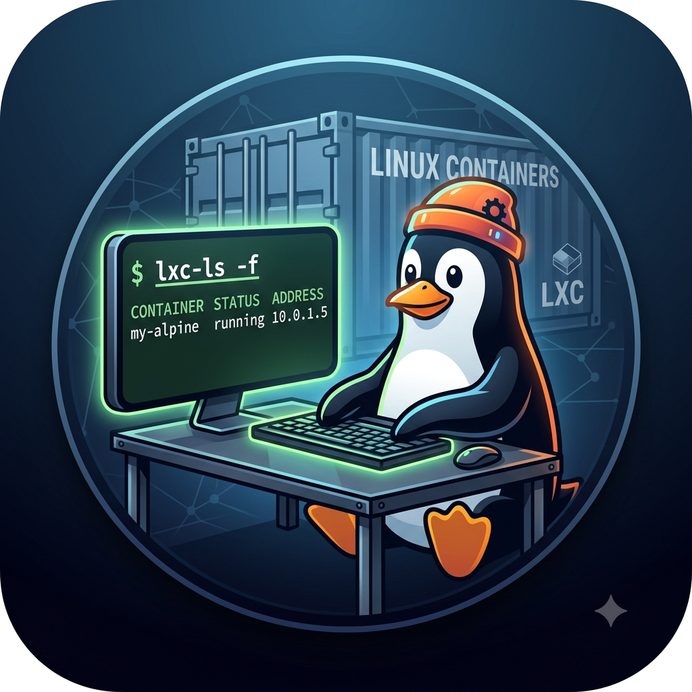

<div align="center">
  
  <h1>TuxBox</h1>
  <p><strong>Containers Linux no Android, com terminal integrado, X11 opcional e diagnósticos reais de kernel/GPU.</strong></p>
  <p>
    <a href="https://github.com/otaviomorais/tuxbox/releases/latest"></a>
    <a href="https://github.com/otaviomorais/tuxbox/blob/main/LICENSE"></a>
    <a href="https://github.com/otaviomorais/tuxbox/stargazers"></a>
    <a href="https://github.com/otaviomorais/tuxbox/forks"></a>
  </p>
</div>

> [!CAUTION]
> **O TuxBox exige root e é um projeto experimental.** Ele cria namespaces, montagens, device nodes e regras de rede no Android. Faça backup e leia [Segurança](./SECURITY.md) antes de instalar. Não use em aparelho que você não possa recuperar.

## O que é o TuxBox

O TuxBox transforma um Android com root em um ambiente para executar
containers Linux (rootfs) — sem `systemd-nspawn`, LXC ou `runc`. O app instala
um rootfs, cria o ambiente com namespaces e `pivot_root`, e conecta um
terminal embutido ao processo do container.

A implementação é dividida em três partes:

1. **App Android** — painel, downloader/importador, gerenciador de rootfs,
   terminal multi-aba, foreground service e diagnósticos.
2. **Scripts shell embarcados** — `unshare`, bind mounts, `pivot_root/chroot`,
   `/dev`, `/proc`, `/sys`, rede, GPU e integração X11.
3. **Ponte nativa `ptyd`** — conecta cada aba do terminal Java a uma PTY
   real, com stdin/stdout, redimensionamento e exit code.

```mermaid
flowchart LR
    A[App Android] -->|libsu / su| B[ptyd]
    B --> C[script tuxbox]
    C -->|unshare + mounts| D[pivot_root / chroot]
    D --> E[rootfs Linux]
    C -. opcional .-> F[Termux:X11]
    C -. opcional .-> G[/dev/kgsl + Mesa / Turnip]
```

Namespaces melhoram o isolamento, mas **não são uma fronteira de segurança**
contra exploits no kernel ou no host.

## Recursos

| Área | O que o app faz |
|---|---|
| Rootfs | Lista o índice público do linuxcontainers.org, mostra distro/release/arquitetura, instala e reutiliza o archive `.tar.xz` |
| Importação | Importa um rootfs local pelo seletor de arquivos do Android, com fallback de descompressão XZ |
| Containers | Lista, abre, testa, repara permissões/SELinux e remove ambientes instalados |
| Terminal | Terminal embutido, múltiplas abas, teclas extras, copiar/colar, resize e sessões persistentes em foreground service |
| Rede | Namespace de rede opcional com bridge, NAT e regras de firewall; desligado por padrão |
| Interface gráfica | Servidor Termux:X11 compartilhado, watchdog, recuperação automática e gerenciador de janelas opcional |
| GPU | Diagnóstico de DRM/KGSL/ION, Vulkan, OpenGL e instalação Mesa/Turnip em distros compatíveis |
| Diagnóstico | Testa namespaces, `pivot_root`, `mknod`, ferramentas, SELinux, rede, Termux:X11 e shell do rootfs em tempo real |
| Logs | Boot, X11, watchdog, GPU, PTY e diagnóstico em arquivos locais para análise e depuração |

## Requisitos

| Requisito | Detalhe |
|---|---|
| Android | **10 ou superior** (`minSdk 29`) |
| Root | Magisk, KernelSU ou outra solução que forneça `su` |
| Kernel | **4.19+** e suporte a mount namespace |
| Arquitetura | `arm64-v8a`, `armeabi-v7a` ou `x86_64` |
| GUI opcional | App **Termux:X11** instalado separadamente |
| Rede | Opcional; a interface de containers não precisa de rede |

O modo container exige um mount namespace funcional. Outros namespaces são
usados quando o kernel permite. Android 32-bit `x86` não possui o binário
`ptyd` necessário e deve ser considerado não suportado.

## Instalação

1. Baixe a APK em [Releases](https://github.com/otaviomorais/tuxbox/releases/latest).
2. Verifique o SHA-256 publicado junto da APK.
3. Instale manualmente pelo Android. O TuxBox não está no Google Play e usa
   permissões de foreground service indisponíveis para a distribuição normal
   na loja.
4. Abra o app, conceda root e rode **Verificar requisitos**.
5. Use **Instalar binários** para extrair os helpers na pasta privada do app.
6. Em **Baixar / Importar**, escolha uma imagem e abra o terminal.

> **Migração de builds de teste:** as APKs de desenvolvimento anteriores eram
> assinadas com a chave de depuração. A primeira release pública usa uma chave
> de produção nova. Se o Android informar conflito de assinatura, desinstale
> a APK antiga e instale a release. Faça backup: os containers ficam em
> `/data/local/tuxbox`, fora do armazenamento privado do app.

## Primeiros passos

### 1. Instale um rootfs

Na aba **Baixar / Importar**:

- escolha a distribuição e a release oferecidas para sua ABI;
- confirme a arquitetura detectada;
- dê um nome opcional ao ambiente;
- toque em **Baixar e instalar**.

O app consulta
[`images.linuxcontainers.org`](https://images.linuxcontainers.org/) e
considera imagens `default`. O conjunto de distribuições muda conforme o
índice; Debian e Ubuntu aparecem no topo quando disponíveis. Uma cópia do
archive fica em `Download/TuxBox` e pode ser reutilizada.

Nenhuma imagem rootfs é embutida na APK ou no repositório.

### 2. Abra o terminal

Escolha o container e uma sessão nova. As opções principais são:

- **Rede isolada (`--net`)** — cria um namespace com bridge/NAT para o
  container. A ausência da opção mantém a rede desligada.
- **Interface gráfica (`--gui`)** — inicia o Termux:X11 e disponibiliza
  `DISPLAY=:0` dentro do container.

Várias abas do mesmo rootfs compartilham o servidor X. O aparelho usa um
display `:0`; rootfs diferentes disputam esse display e podem exigir
reabertura da sessão gráfica.

### 3. Use o gerenciador de janelas

Se `/root/.wm` existir, o TuxBox executa o comando definido nele. Caso o
arquivo não exista e `openbox` esteja instalado, ele usa
`openbox --sm-disable`. O X11 pode funcionar sem WM, mas algumas aplicações
precisam de um.

## GPU e X11

O modo GUI usa o servidor X nativo do Termux:X11. Um watchdog observa o
listener real em `/proc/net/unix`, mantém heartbeat e restaura o servidor
quando necessário. O estado é compartilhado por rootfs sempre que possível.

Para Android/Adreno, o TuxBox pode expor `/dev/kgsl-3d0`, `/dev/ion` e
`dma_heap` ao container. O perfil padrão é:

- **OpenGL/GLX:** `llvmpipe`, para estabilidade;
- **Vulkan:** Turnip sobre KGSL, quando disponível;
- **OpenGL acelerado:** opcional via marcadores `kgsl` ou `zink` dentro do
  container.

GPUs sem backend compatível continuam usando renderização por software. A
aceleração depende do device node, kernel, driver, ROM e imagem Linux.

> O instalador Mesa pode extrair um pacote de desenvolvimento dentro do
> container como root e usa `dpkg-divert` em algumas distros. Consulte
> [SECURITY.md](./SECURITY.md) antes de habilitar esse recurso.

## Diagnóstico

O botão **Diagnóstico do kernel** não adivinha recursos em
`/proc/config.gz`: ele executa testes reais em um scratch descartável e
remove tudo ao final. O relatório pode ser copiado para a área de transferência
e classifica o aparelho como:

- **Completo** — todas as capacidades usadas pelo TuxBox estão disponíveis;
- **Funcional** — o container sobe, mas há capacidades ausentes;
- **Incompatível** — o requisito principal (mount namespace) não existe.

O diagnóstico da GPU mostra DRM/KGSL/ION, drivers, ICDs Vulkan e executa
`vulkaninfo`, `vkmark`, `glxinfo` ou `eglinfo` quando eles existem no
container.

## Arquitetura no aparelho

| Caminho | Uso |
|---|---|
| `/data/local/tuxbox/<nome>` | Rootfs instalado |
| `/data/local/tuxbox-archives` | Archives reutilizáveis |
| `/data/local/tuxbox-logs` | Log global da ponte PTY |
| `Download/TuxBox` | Cópia visível dos archives baixados |
| `<app files>/bin` | Scripts extraídos pelo app |
| `<rootfs>/var/log/tuxbox-boot.log` | Log de boot do container |
| `<rootfs>/var/lib/tuxbox-x11*` | Socket e estado do X11 |

## Compilando

Requisitos:

- JDK 17;
- Android SDK 34 e Build Tools;
- `./gradlew` do repositório (Gradle 8.9 incluído).

```bash
export ANDROID_HOME="$HOME/Android/Sdk"

# APK de desenvolvimento
./gradlew :app:assembleDebug

# APK release sem assinatura
./gradlew :app:assembleRelease

# lint
./gradlew :app:lintDebug
```

Saídas:

```text
app/build/outputs/apk/debug/app-debug.apk
app/build/outputs/apk/release/app-release-unsigned.apk
```

O `gradle.properties` limita memória, workers e daemon para permitir builds
também em aparelhos Android.

### Testes

```bash
./tool/test/tuxbox-kernel-check.test.sh
./tool/test/ensure-x11-clients.test.sh
```

O teste Arch real é opt-in e requer uma imagem local:

```bash
RUN_ARCH_TAR_TEST=1 \
ARCH_TAR=/caminho/rootfs-arch-arm64.tar.xz \
./tool/test/ensure-x11-clients.test.sh
```

### Binário `ptyd`

As três ABIs já são versionadas, com checksums em
`app/src/main/assets/ptyd/SHA256SUMS`. Para reconstruí-las, são necessários
NDK r26d, QEMU e as ferramentas/systemroot x86_64. O caminho do script é
relativo ao repositório; o NDK pode ser configurado sem editar o código:

```bash
NDKBIN="$HOME/android-ndk-r26d/toolchains/llvm/prebuilt/linux-x86_64/bin" \
QEMU=qemu-x86_64 \
QEMU_SYSROOT=/usr/x86_64-linux-gnu \
python3 tool/build-ptyd.py
```

### Assinatura de release

A keystore e as senhas **nunca devem entrar no Git**. Mantenha uma cópia
segura da chave: sem ela, o Android não aceitará atualizações assinadas pela
mesma identidade. A APK release gerada pelo Gradle fica sem assinatura; alinhe com
`zipalign` e assine com `apksigner` antes de publicar.

## Release atual

**TuxBox 1.0.0 — build interno v3.47**

- diagnóstico real de capacidades do kernel/root;
- servidor X11 compartilhado com watchdog e recuperação;
- integração de clientes X11 em Arch Linux;
- instalação automática de XKB e ferramentas de GUI;
- diagnóstico e instalação Mesa/Turnip para GPU;
- rootfs extraído como root e archive reutilizado;
- terminal multi-aba com persistência via foreground service.

Consulte a [release](https://github.com/otaviomorais/tuxbox/releases/tag/v1.0.0-v3.47)
para a lista completa, assinatura e checksum.

## Privacidade e conteúdo

- Não há telemetria, analytics, crash reporting ou backend próprio.
- `INTERNET` é usado para consultar o índice de rootfs, baixar imagens e,
  opcionalmente, obter o pacote Mesa.
- Containers e downloads ficam no armazenamento do aparelho.
- O repositório, a APK e a release **não contêm jogos, ROMs, saves, keys de
  licença ou arquivos de jogos**.

## Limitações conhecidas

- exige root e um kernel com mount namespace;
- o modo GUI depende do Termux:X11 e pode ser bloqueado por SELinux;
- o display X11 é único por aparelho;
- o modo Arch reduz a confiança restrita à keyring oficial do `pacman`;
- a instalação Mesa depende de assets de terceiros e requer cautela;
- rootfs grande consome bastante espaço em `/data`;
- notificações são necessárias para manter sessões em segundo plano;
- rootfs de terceiros e scripts executados dentro deles podem fazer o que
  quiserem com o acesso root recebido.

## Contribuindo

Issues e pull requests são bem-vindos. Antes de enviar uma alteração:

- rode os dois testes shell e `./gradlew :app:lintDebug`;
- não inclua keystores, senhas, rootfs, APKs de terceiros ou conteúdo de jogos;
- mantenha avisos SPDX/copyright e atribuições;
- documente mudanças de segurança ou de formato de rootfs;
- não altere o certificado de assinatura de releases já publicadas.

Veja [THIRD_PARTY_NOTICES.md](./THIRD_PARTY_NOTICES.md) e
[docs/UPSTREAM.md](./docs/UPSTREAM.md) para atribuições.

## Licença e créditos

Copyright © 2026 LongQT-sea e colaboradores do TuxBox. O projeto está sob
[GPL-3.0-only](./LICENSE).

O terminal é adaptado do [Termux](https://github.com/termux/termux-app) e
inclui contribuições de projetos como
[Android Terminal Emulator](https://github.com/jackpal/Android-Terminal-Emulator)
e [wcwidth](https://github.com/termux/wcwidth). TuxBox é independente e não
é afiliado ao Termux, Android, Google, Magisk ou KernelSU.
